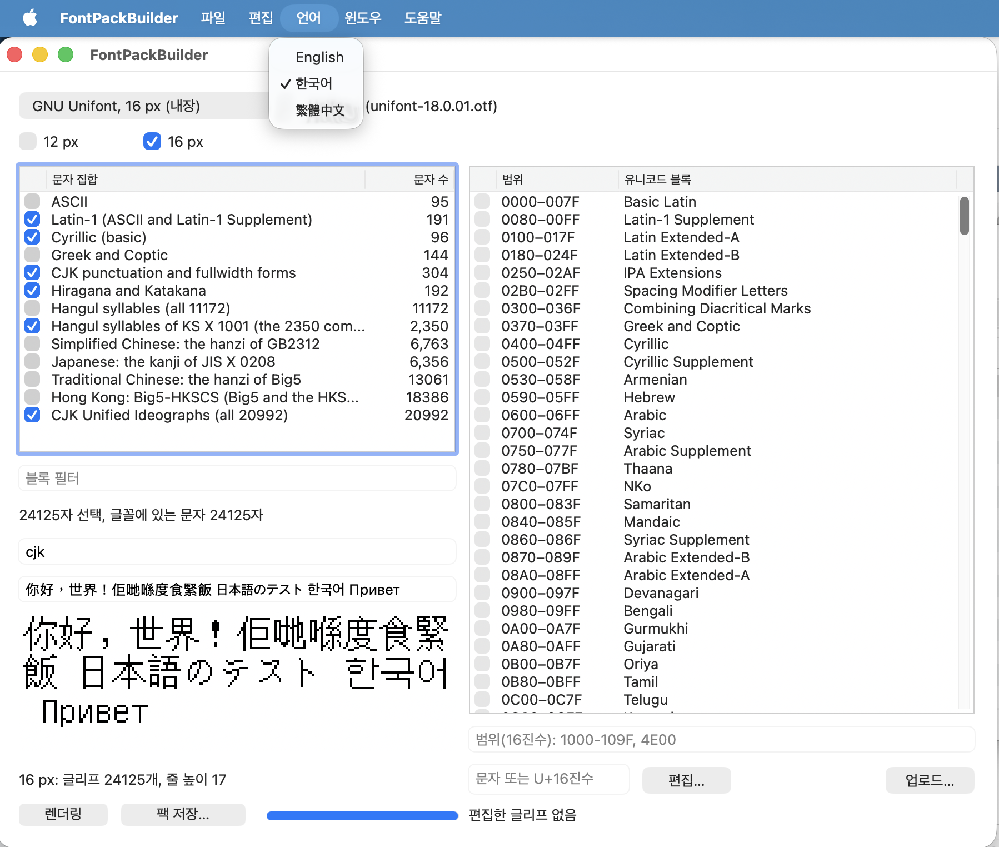
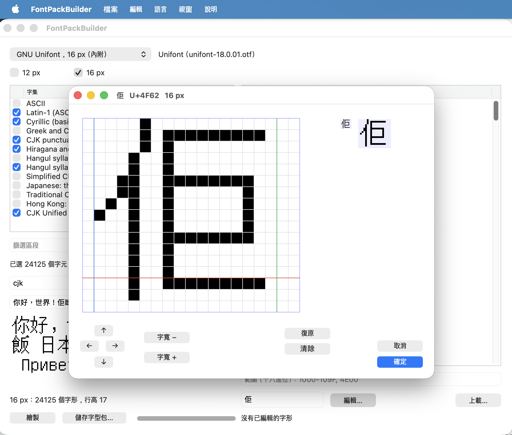
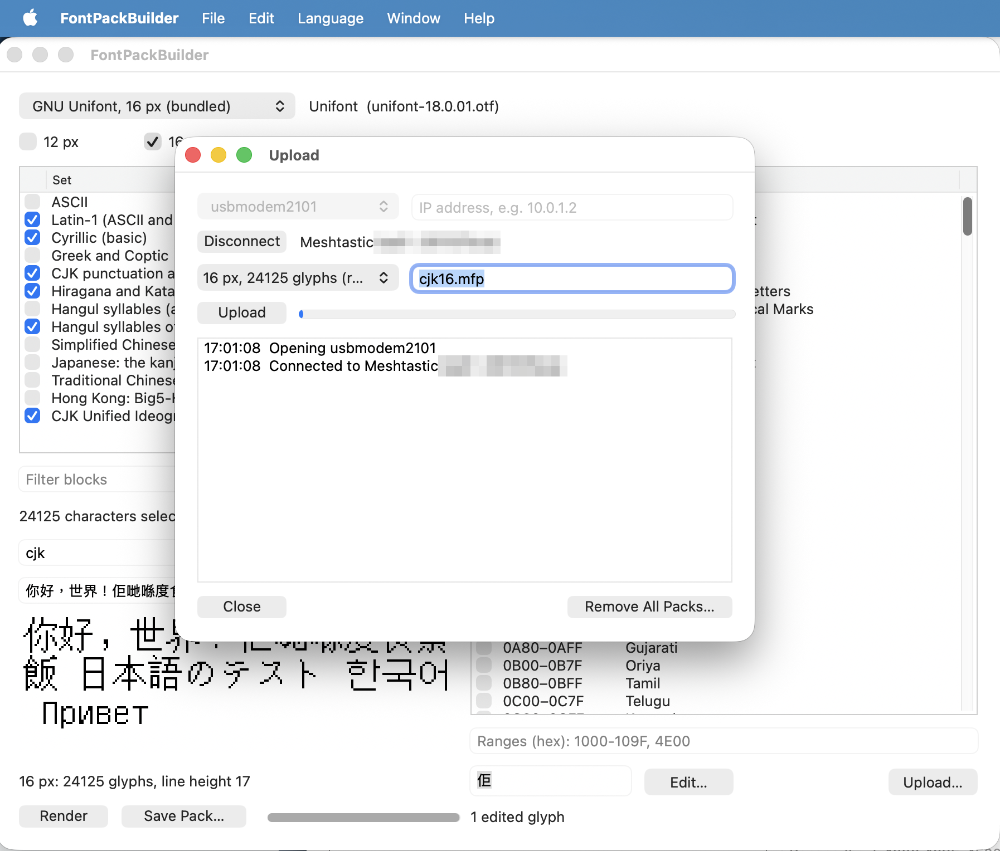

# FontPackBuilder

A macOS and Windows app (Xojo) that builds **Meshtastic Font Packs** (`.mfp`): the glyphs of one font at one pixel size,
for the characters a device's built-in font doesn't have (Chinese, Japanese, Korean, Cantonese...). The format, the
firmware side and command-line tools are in [MeshtasticFontPacks](https://github.com/Kongduino/MeshtasticFontPacks).

- **Font:** GNU Unifont (16 px) or Fusion Pixel (12 px, Hong Kong forms), both bundled, or any `.ttf`/`.otf`/`.ttc`.
- **Characters:** named sets (GB2312, Big5, HKSCS, JIS X 0208, KS X 1001, kana...), Unicode blocks (with a filter),
  and hex ranges (`1000-109F, U+4E00`). The app counts the selected characters and those the font has.
- **Sizes:** 12 px, 16 px, or both (one pack each).
- **Glyph editor:** any glyph magnified, with its line box, baseline, pen and advance: draw, move, change the advance,
  revert to the font's. A character the font doesn't have can be drawn from scratch. Edits are kept across renders.
- **Packs** are written in format version 2, the same bytes as `mkfontpack.py` for the same font and characters.
- **Upload:** a rendered pack or a pack file goes to a device over USB serial or TCP (the firmware's XModem transfer),
  to `/fonts/<name>.mfp`; the device checks it before installing it. When there's no room beside the old pack, the app
  offers to remove that one first. **Remove All Packs** removes every pack from the device (files and flash slots).
- **Languages:** English, 繁體中文 or 한국어, chosen in the Language menu (see Languages below).

Glyphs are drawn with CoreText, anti-aliasing and font smoothing off, which matches FreeType's mono rendering (the
Python generator's) pixel for pixel, but for a few accents that rise above the ascender line. On Windows, GDI draws them
the same way (anti-aliasing off, the font's own glyph by its index), with the advances and the ascent taken from the
font's tables, as CoreText reports them.

## Screenshots

Choosing the characters and rendering a 16 px pack, in Korean, with the Language menu open:

Editing a glyph, 佢 (U+4F62), magnified, in Traditional Chinese:

Uploading a pack to a device over USB, in English:

## Building

1. `Resources/Fonts/fetch_fonts.sh` downloads the two bundled fonts (their licences are in that folder).
2. Open `FontPackBuilder.xojo_project` in Xojo (2026r2 or later) and run or build it. A Copy Files build step puts
   `Resources/Blocks.txt`, `Resources/CharSets.txt` and `Resources/Fonts` in the app; run from the IDE, the app finds
   them next to the project.

`Resources/CharSets.txt` comes from MeshtasticFontPacks (`tools/export_sets.py`), so both tools select the same
characters; `Resources/Blocks.txt` is the Unicode Character Database's block list.

## Languages

The interface is in English, 繁體中文 or 한국어, chosen in the **Language** menu; the choice applies to every open
window at once and is remembered. By default the app uses the system language when there's a file for it. The
Korean texts still need a review by a native speaker.

Each language is a JSON file in `Resources/Languages` (`en.json`, `zh-Hant.json`, `ko.json`): `"_language"` is its name
in its own script, then one `"key": "text"` per text, with `{placeholders}` the app fills in (`"status.saved": "Saved
{file}: {glyphs} glyphs, {bytes} bytes"`). A text a file doesn't have is shown in English. To add or try a language
without rebuilding the app, put its file in `~/Library/Application Support/FontPackBuilder/Languages` (on Windows
`%APPDATA%\FontPackBuilder\Languages`); a file there replaces a built-in one of the same name. `tools/check_strings.py`
checks the keys the code uses against `en.json`, and each translation against `en.json` (missing or extra keys,
placeholders that differ).

## Next

Project files (font, selection, edits), compressed transfers, Linux.

## Licence

GPL-3.0 (see `LICENSE`). The bundled fonts keep their own licences: Fusion Pixel Font (TakWolf) is OFL-1.1; GNU Unifont
is OFL-1.1 or GPL-2.0-or-later with the font embedding exception.
